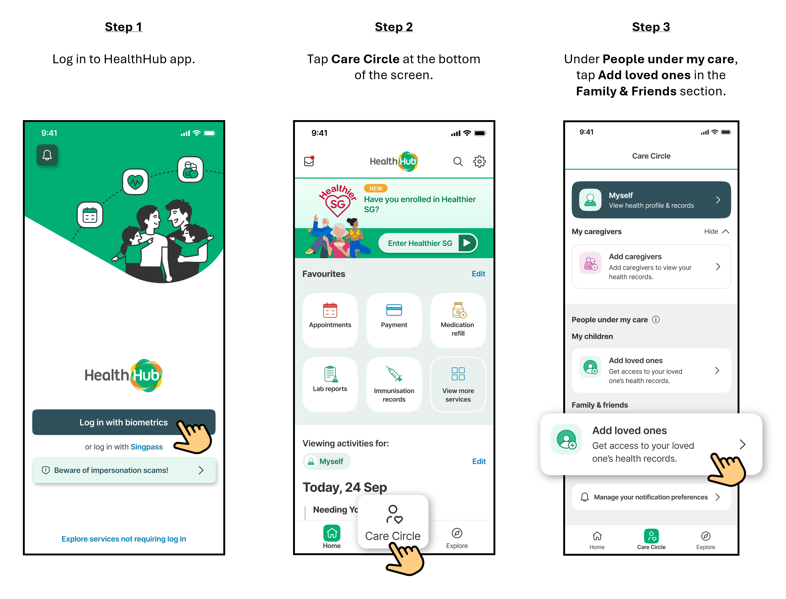
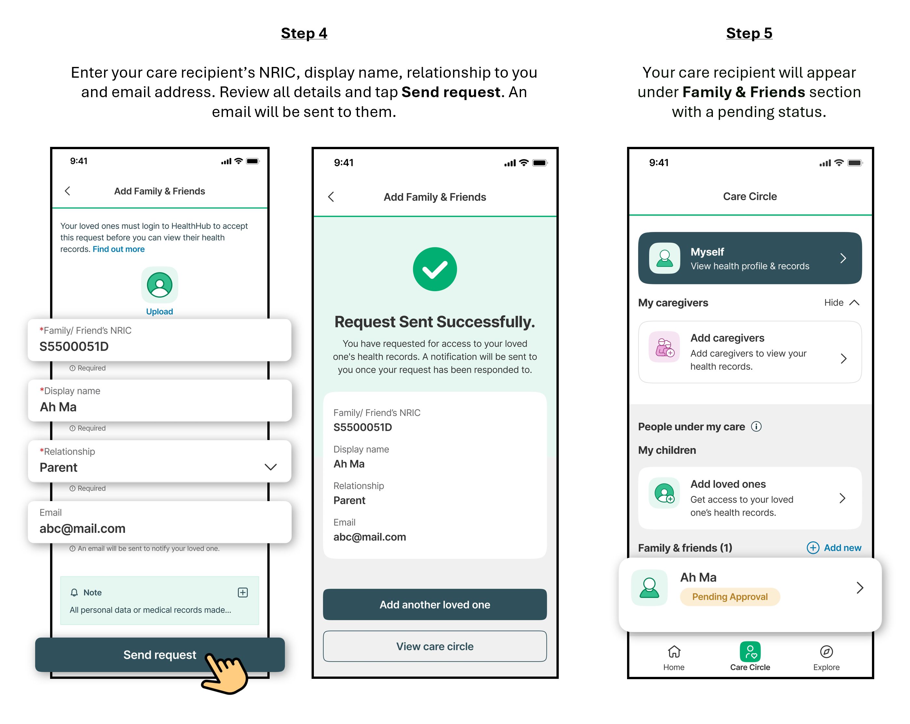
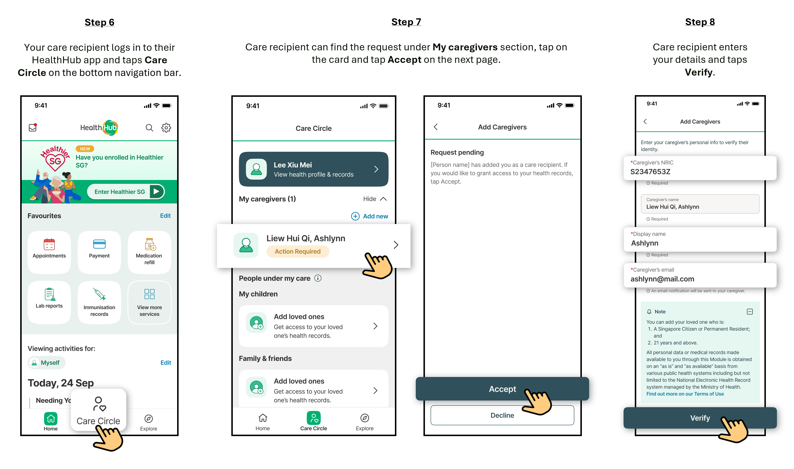
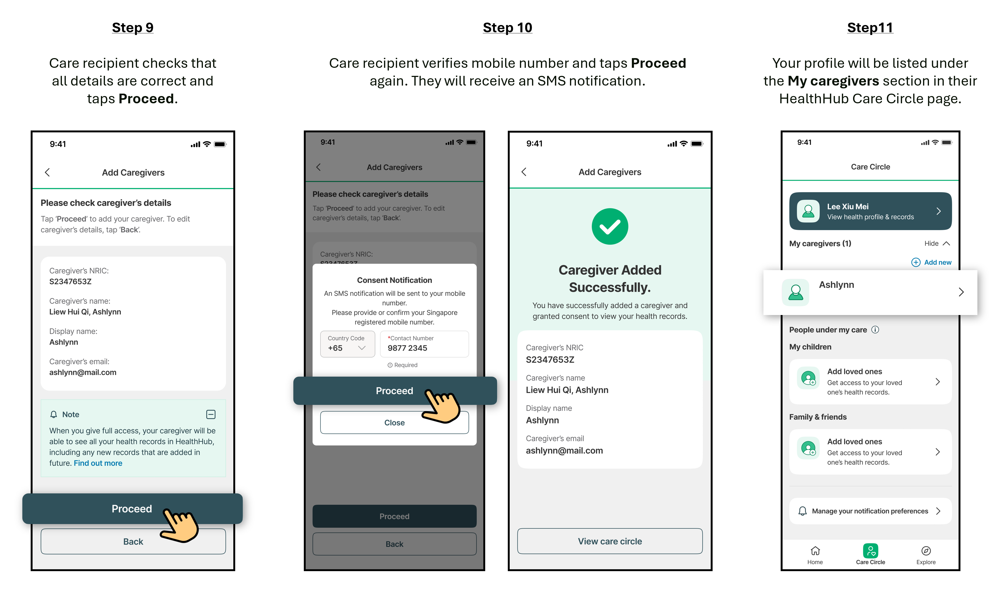
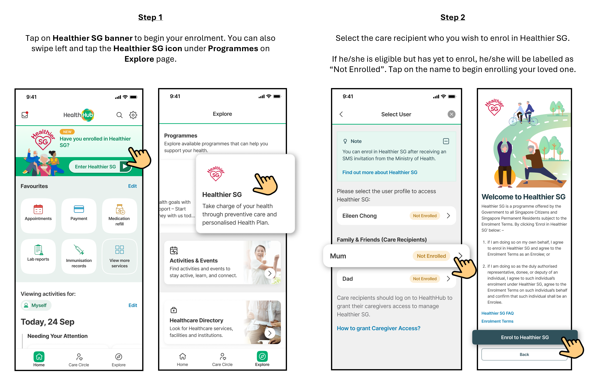

### If you're a caregiver, here's how you can assist your family members to enrol in Healthier SG!

With the consent of your family members, you can be given access to help them enrol in Healthier SG and view their Health Plans on the HealthHub app.

First, follow these steps to set up access as a caregiver on your care recipient’s HealthHub app.

   
Next, inform your care recipient to accept your request in their HealthHub account. Here are the steps.

After care recipient has accepted your request, you can view your care recipient’s profile on your Care Circle page. 

You may continue to assist your loved ones to enrol in Healthier SG and access Healthier SG related functions on their behalf by following these steps.

 
 
For more information on how to add a caregiver, please refer to [Health Profiles –](https://support.healthhub.sg/hc/en-us/categories/15435095166489-Health-Profiles) [HealthHub](https://support.healthhub.sg/hc/en-us/categories/15435095166489-Health-Profiles) [Frequently Asked Questions (FAQ)](https://support.healthhub.sg/hc/en-us/categories/15435095166489-Health-Profiles) (https://support.healthhub.sg/hc/en-us/categories/15435095166489-Health-Profiles).