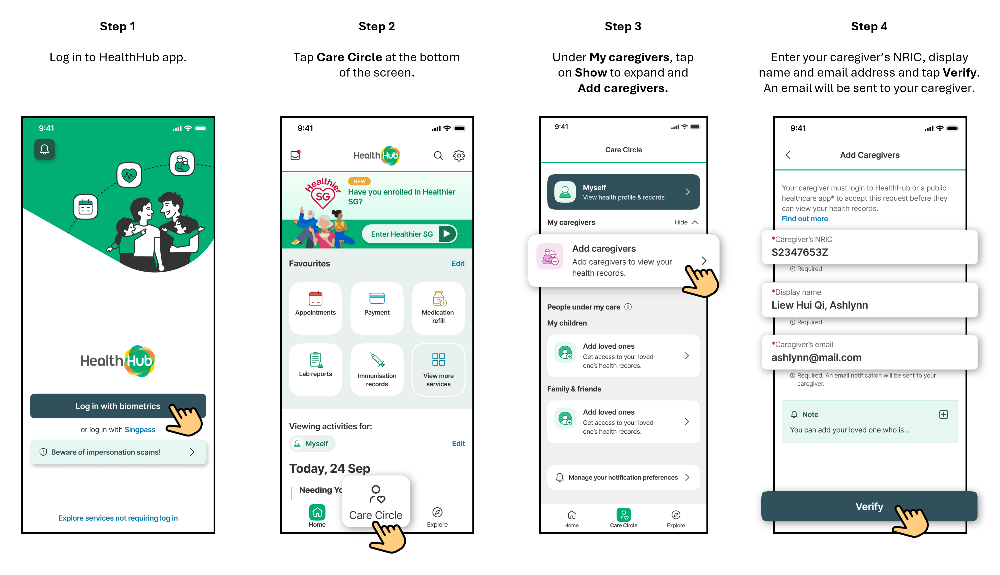
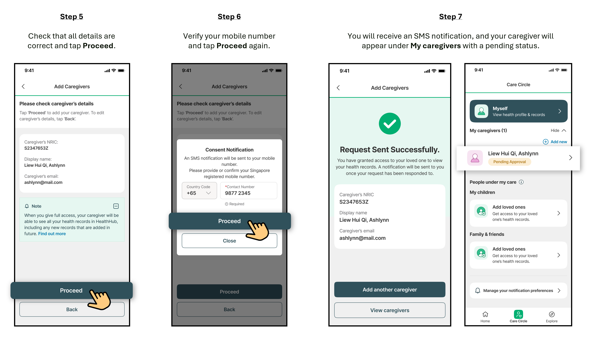
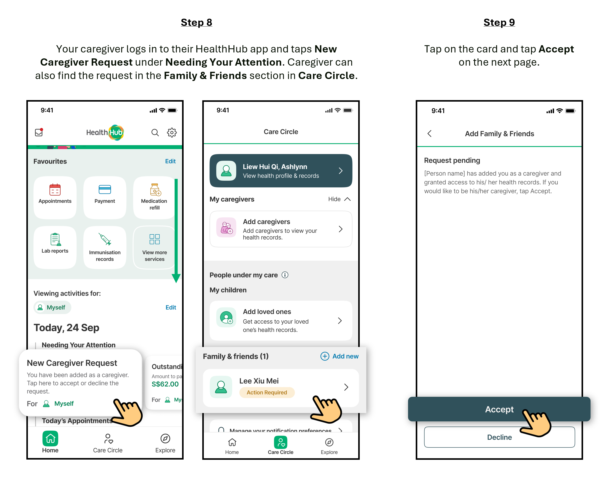
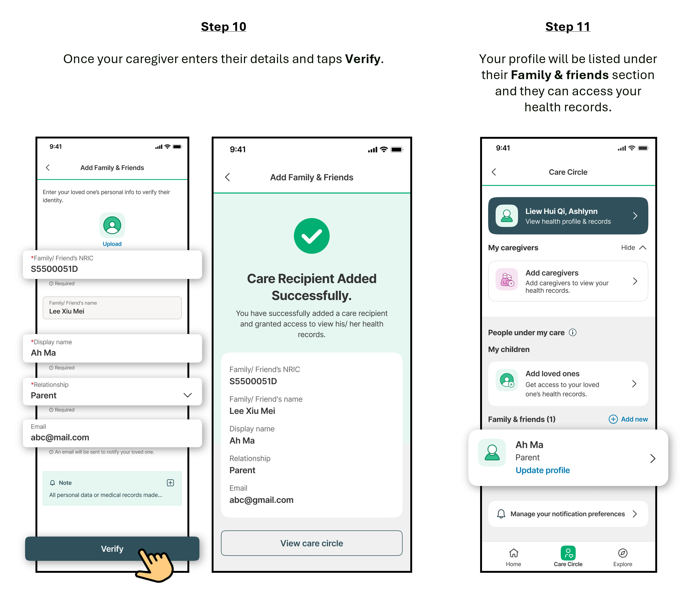

   

You can grant access to your family members or loved ones to assist you with your enrolment by adding them as your caregiver in HealthHub which gives them access to view your health records and manage your e-Services.

You will need your Singpass account to log in to HealthHub. If you do not have a Singpass account, you may register for Singpass through this website \- [https://www.singpass.gov.sg/home/ui/register/instructions](https://www.singpass.gov.sg/home/ui/register/instructions) or head down to the nearest Singpass counter with your caregiver for assistance. Do bring along both your NRICs. For Singpass counter locations, see: [https://www.singpass.gov.sg/home/ui/counter-locations](https://www.singpass.gov.sg/home/ui/counter-locations).

Follow the steps below to add a caregiver.

   

Next, inform your caregiver to accept your request in their HealthHub account. Here are the steps:

  
Once your caregiver has successfully added you as a care recipient, your user profile will be shown on HealthHub for them to assist with your enrolment if you are eligible to enrol in Healthier SG.

  
Alternatively, you may enrol in Healthier SG by accessing the HealthHub web portal at [https://www.healthhub.sg](https://www.healthhub.sg/) on a computer and logging in with your Singpass.

For more information on how to add a caregiver and control your caregiver’s access to your health records go to: [https://support.healthhub.sg/hc/en-us](https://support.healthhub.sg/hc/en-us).